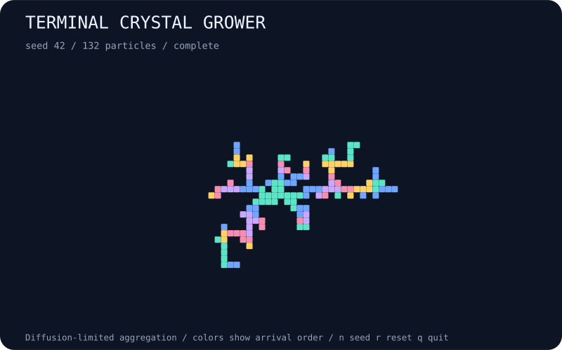

# terminal-crystal-grower

Grow branching lattice crystals from seeded random walks.



## Run

```bash
npx --yes github:b69ca/terminal-crystal-grower
```

Node.js 20 or newer. No runtime dependencies. Everything runs locally.

## Play

| Key | Action |
| --- | --- |
| `p` / Space | Pause or resume |
| `.` | Pause and advance one step |
| `n` | Start the next seed |
| `r` | Reset the current seed |
| `+` / `-` | Faster or slower display |
| `q` / Ctrl-C | Quit and restore the terminal |

One live tick and `.` each run up to 1,000 walker attempts. A completed crystal stays visible until `n` or `r`. Grid height limits growth radius, so taller grids produce larger crystals.

Live mode uses an alternate screen and restores the cursor and input mode on exit. `--no-color` or `NO_COLOR=1` disables ANSI colors. The live grid fits the terminal at startup; explicit sizes make runs reproducible across terminals. Very small terminals may clip the minimum grid.

## Export

```bash
npx --yes github:b69ca/terminal-crystal-grower --seed 42 --steps 600 --svg preview.svg
npx --yes github:b69ca/terminal-crystal-grower --seed 42 --steps 600 --json
npx --yes github:b69ca/terminal-crystal-grower --frames 100
```

Common flags: `--seed N` (0–4294967295), `--width N` (21–121), `--height N` (15–61), `--steps N` (0–10000), `--frames N` (0–100000), `--json`, `--svg FILE`, `--no-color`, and `--help`.

Live mode begins at step zero; exports and piped output default to 600 steps. `--steps 0` shows the initial state. JSON and SVG may be combined; neither accepts `--frames`. Piped terminal output shows at most one plain frame without escape sequences. Live frames show the starting state first, advance between frames, and count paused frames toward the limit. Exit codes: 0 success, 2 argument or file error.

## How it works

Diffusion-limited aggregation grows a connected cluster on a square lattice. A single walker launches on a ring just beyond the current cluster and takes cardinal random steps until it touches an occupied neighbor. It then sticks permanently. Escaping walkers are discarded and relaunched. One tick budgets up to 1,000 walker attempts; a partly completed walk carries into the next tick. Growth stops when the cluster reaches the shortest available radius minus two cells. Colors group particles by arrival order, and the center is marked +. Completion is a radius limit, not a filled grid, and a fixed step budget may end before completion. This is procedural artwork inspired by crystal growth, not a mineral or snowflake model. JSON reports particle count, radius, hop count, and completion, not individual cells.

## Library

Install with `npm install github:b69ca/terminal-crystal-grower`, then:

```js
import { createWorld, step, analyze, renderSVG } from 'terminal-crystal-grower';
const world = createWorld({ seed: 42, width: 81, height: 41 });
step(world, 600); // Mutates and returns world.
console.log(analyze(world));
const svg = renderSVG(world);
```

Renderers and `step` accept worlds returned by `createWorld`. Keep the returned state intact. Changing dimensions or internal arrays after construction is unsupported.

## Development

```bash
npm ci
npm run check
```

Tests cover deterministic seeds, incremental updates, model invariants, bounds, render dimensions, CLI errors, and exports. GitHub Actions runs Node.js 20, 22, and 24.

## License

MIT
